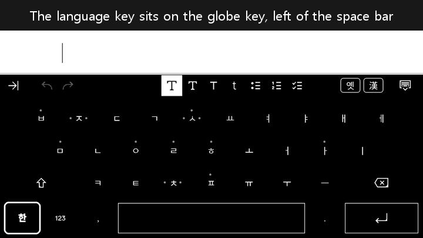

# rmpp-lang



*Korean on the on-screen keyboard: Hangul, Hanja conversion and Old Hangul (recorded on the Paper Pro with [rmpp-studio](https://github.com/lorancecall/rmpp-studio)).*

Languages for the reMarkable Paper Pro: a keyboard and a font for each language (Korean with Old Hangul, Japanese,
Chinese, Russian, ...), on the on-screen keyboard and on Type Folio, Bluetooth and USB keyboards. Runs without xovi
and keeps working after a reboot.

Tested on reMarkable Paper Pro, OS 3.29.1.

Made for and tested on the reMarkable Paper Pro with OS 3.29 only; other reMarkable models are not supported and
their compatibility is not guaranteed. Following newer OS versions happens when I have time, and may not happen.

> Part of the **rmpp add-ons**, built on [rmpp-packages](https://github.com/lorancecall/rmpp-packages): it is
> installed by rmpp setup, loaded into xochitl at every boot by rmpp-preload (no xovi), and kept up to date with
> Vellum. How that differs from xovi: [how it works](https://github.com/lorancecall/rmpp-packages/blob/main/docs/how-it-works.md).

rmpp-lang is a small core plus one add-on per language. You pick the languages in the installer:

| Add-on | Keyboard | Font (default) |
|---|---|---|
| `ko` Korean (with Old Hangul / 옛한글) | 2-beolsik on screen; Hangul composed from physical keys too; Hanja; Old Hangul | Noto Sans KR |
| `ru` Russian | ЙЦУКЕН on screen and on physical keyboards | reMarkable's own (covers Cyrillic) |
| `bg` Bulgarian | BDS 5237:2006, new or traditional phonetic (chosen in Settings), on screen and on physical keyboards; Ѝ by long press on И, „ “ on the comma key | reMarkable's own (covers Cyrillic) |
| `ja` Japanese | romaji (nihongo -> 日本語); also by sound in Hangul (니혼고 -> 日本語) | Noto Sans JP |
| `zh` Chinese | pinyin (zhongguo -> 中国); also by sound in Hangul (중궈 -> 中国) or Korean Hanja readings (중국 -> 中国) | Noto Sans SC |

The Hangul options of Japanese and Chinese type on the Korean keyboard, so their packages install `ko` as well.

English is always there. More languages are welcome: see [Add a language](docs/FONTS.md#add-a-language).

## Install

Start at **[rmpp-packages](https://github.com/lorancecall/rmpp-packages#install)**: it explains developer mode and
has **rmpp setup**, the installer for all rmpp add-ons.

- In rmpp setup (the desktop app or the script), tick **Languages: keyboards and fonts per language** (rmpp-lang;
  selected by default, with Korean), then the languages you want.
- It installs `rmpp-preload` with it; each language (`rmpp-lang-<code>`) installs `rmpp-lang`, and Japanese and
  Chinese also install `rmpp-lang-ko` ([all packages and dependencies](https://github.com/lorancecall/rmpp-packages/blob/main/docs/packages.md)).
- After a reMarkable OS update: **Restore** in rmpp setup.
- Without rmpp setup, removing it, next to other mods, building it: [docs/install.md](docs/install.md).

## Use

- **Settings > Languages** (above Handwriting): the installed languages in keyboard order (▲▼ to reorder), and a
  page per language to turn its keyboard on or off and choose its font, with a sample line.
- **On-screen keyboard:** turn the language on in Settings > Language & keyboard, then switch with the language
  key (bottom left, where the globe key was).
  Korean jamo join into syllables as you type (ㅎ ㅏ ㄴ → 한); backspace removes one jamo at a time; Shift gives
  ㅃ ㅉ ㄸ ㄲ ㅆ ㅒ ㅖ.
- **Type Folio, Bluetooth and USB keyboards:** **Ctrl+Space** or **right Alt / right Cmd** cycles through English
  and the languages with a keyboard, in Settings order. The on-screen keyboard follows.
- **Hanja (Korean):** tap **漢** on the format bar, or press the Hanja key or **F9**, to turn the Hangul before
  the cursor (or the selected word) into Hanja: pick from the candidates (1-9 on a physical keyboard).
- **Old Hangul (옛한글):** turn on Settings > Languages > Korean > Old Hangul, then the **옛** button on the format
  bar types ㆍ ㅿ ㆆ ㆁ ㅸ, old initial clusters and the tone dots (방점); they compose with the keyboard (ᄆᆞᆯᄊᆞᆷ).
- **Japanese:** turn on the Japanese keyboard in Settings > Languages, switch to it (日) and type romaji on the
  Latin keys: `nihongo`, then Space (or **変** / F9) converts to 日本語; Space picks the first candidate. Also
  supported, by sound in Hangul on the Korean keyboard: 니혼고 -> 日本語, 다베마스 -> 食べます. Choose in Settings >
  Languages > Japanese > Input.
- **Chinese:** switch to Chinese (中) and type pinyin: `zhongguo`, then Space (or **汉**) converts to 中国, with
  predictions. Also supported: Mandarin by sound in Hangul (중궈 -> 中国, 베이징 -> 北京) or Korean Hanja readings
  (중국 -> 中国 / 中國). Choose in Settings > Languages > Chinese > Input.
- **Language key:** the bottom-left key of the on-screen keyboard shows the current language (EN, 한, RU, ...);
  tap it to switch, in Settings > Languages order. It is the same in every text field, with or without the format
  bar. In fields without the format bar (text objects, dialogs) a bar of the same kind appears above the keys while
  the language needs it: 漢 / 変 / 汉 and their candidates, 옛.
- **External keyboards:** while a Bluetooth or USB keyboard is connected, the on-screen keys fold away and the
  format bar stays. With [rmpp-bt](https://github.com/lorancecall/rmpp-bt) you can set a keyboard to **Type Folio
  mode** instead.

## Fonts

Each language uses one font everywhere its script appears: typed text, the keyboard, file names and the rest of
the Paper Pro. Fonts change at once, without a restart. The defaults are the Noto fonts that come with the Paper Pro.

Add your own (`.ttf`, `.otf`, `.ttc`) from your computer with [tools/rmpp-lang.py](tools/rmpp-lang.py), or on the
Paper Pro:

```sh
rmpp-lang font add /home/root/MyFont-Regular.ttf --lang ko --use
rmpp-lang font list
```

Full guide with language codes: **[docs/FONTS.md](docs/FONTS.md)**.

## For other add-ons

rmpp-lang writes `/home/root/.config/rmpp-lang/state.json` (languages, order, keyboards, fonts) and `fonts.json`
(one family and a readable font file per language), so other add-ons can follow the user's languages and fonts;
[rmpp-hwr](https://github.com/lorancecall/rmpp-hwr) draws converted ink with them. Format: [docs/DESIGN.md](docs/DESIGN.md).

## How it works

`librmpp-lang.so` is loaded into xochitl at boot by `rmpp-preload` (a launcher that adds the add-ons in its
`preload.d/` to `LD_PRELOAD`, after xovi's if xovi is in use). It finds the language add-ons in
`/home/root/.local/share/rmpp-lang/languages/`, registers their on-screen layouts (`<code>.rcc`) next to the
built-in ones, sets one fallback font per script with `QFontDatabase::setApplicationFallbackFontFamilies`, maps
physical-keyboard keys per language, and composes Hangul for add-ons with `input=compose:hangul`. The Settings page
is QML from `rmpp-lang.rcc`.

xochitl starts seconds before the encrypted `/home` is mounted, so what it needs at startup (the library,
`rmpp-lang.rcc`, the add-ons' layouts) is on the root file system, in one folder: `/usr/lib/rmpp/rmpp-lang/`,
with the `rmpp-lang` command. Settings, fonts and the add-ons' data are in `/home` (`/home/root/.config/rmpp-lang`,
`/home/root/.local/share`). The root file system is read-only and an OS update replaces it, which is why the
packages put these files back with `vellum reenable`. Design, add-on format and Paper Pro findings:
[docs/DESIGN.md](docs/DESIGN.md).

## Build

Building, the development install and the glyph files: [docs/install.md](docs/install.md#build-and-install-by-hand).

## History

rmpp-lang grew out of rmpp-korean 0.1.0 (Korean keyboard and fonts). There is no upgrade path: remove rmpp-korean
(`vellum del rmpp-korean`) and install rmpp-lang with `rmpp-lang-ko`. See [docs/MIGRATION.md](docs/MIGRATION.md).

## New languages

Ask for a keyboard language with a [language request](https://github.com/lorancecall/rmpp-lang/issues/new?template=language-request.yml),
or send a pull request with an add-on. Every new language is tested on a real Paper Pro, with
[rmpp-studio](https://github.com/lorancecall/rmpp-studio) screenshots of the keyboard and a typed sample: see
[CONTRIBUTING.md](CONTRIBUTING.md).

## License

GPL-3.0-only. See [LICENSE](LICENSE). Fonts you add keep their own licenses. The Hanja dictionary
(`languages/ko/dict/hanja.txt`) comes from [libhangul](https://github.com/libhangul/libhangul) under the
BSD-3-Clause license in its header. The Japanese dictionary (`languages/ja/dict/ja.txt`) comes from
[SKK-JISYO.L](https://github.com/skk-dev/dict) (GPL-2.0-or-later); the Chinese one (`languages/zh/dict/zh.txt`)
from [rime](https://github.com/rime) luna_pinyin and essay (LGPL-3.0) with [OpenCC](https://github.com/BYVoid/OpenCC)
tables (Apache-2.0).
